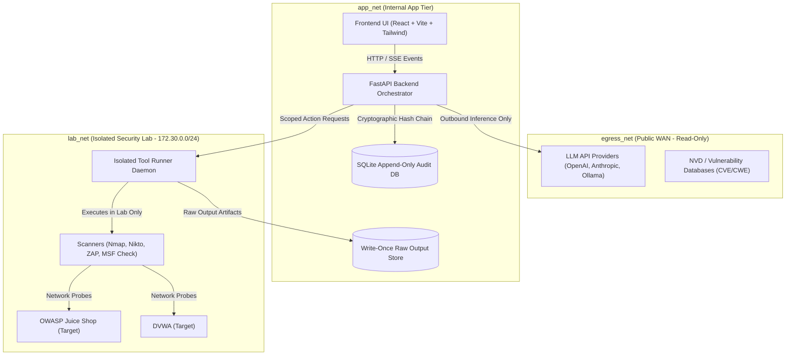

# AI Unified VAPT Agent — Architecture & Security Boundaries

## 1. Network Topology (3-Network Segregation)

To ensure fail-closed offensive safety and prevent accidental scanning of unauthorized infrastructure or public networks, the system enforces a strict 3-tier network topology:

- **`lab_net` (`172.30.0.0/24`)**: Completely isolated Docker network with zero egress to the internet. Contains vulnerable targets (Juice Shop, DVWA) and scanner execution containers.
- **`app_net`**: Internal bridge connecting the frontend, backend, audit repository, and write-once raw storage. Scanners cannot reach this network directly.
- **`egress_net`**: Limited strictly to the backend for outbound LLM API requests and external CVE references. No scanner traffic ever routes through `egress_net`.

---

## 2. End-to-End Data Flow

The assessment lifecycle follows an immutable, deterministic pipeline from scoping through report compilation:

```mermaid
flowchart LR
    A["1. Analyst Scoping & Rules"] --> B["2. Deterministic Scope Engine"]
    B -->|Authorized In-Scope Only| C["3. AI Agent Reasoning Loop"]
    C -->|Propose Scans| D["4. Plan & Scope Check"]
    D -->|Executes| E["5. Live Scanners / Importers"]
    E -->|Write-Once Artifacts| F["6. Ingestion & Normalization"]
    F -->|Cross-Tool Correlation| G["7. Deduplication & Corroboration"]
    G -->|Mathematical Formula| H["8. Deterministic Risk Engine"]
    H -->|Intrusive Actions| I{"9. Human Approval Gate"}
    I -->|Approved via 15-min Token| J["10. Active Validation (Check Modules)"]
    I -->|Rejected / Pending| K["Remains Suspected Finding"]
    J --> L["11. Client-Ready PDF Report"]
    K --> L
    L --> M["12. SHA-256 Hash-Chained Audit Trail"]
```

---

## 3. Strict Security Boundaries & Invariants

### A. No Autonomous Exploitation (Hard Enforcement in Code)
- Active validation and offensive check modules (`action_class="active_validation"`) cannot execute autonomously.
- Enforced at the **adapter code layer** ([`MetasploitAdapter`](file:///backend/app/adapters/metasploit.py)), not merely in the UI.
- Requires:
  1. `ENABLE_ACTIVE_VALIDATION=true` in environment configuration.
  2. Single-use, time-bounded (15-minute TTL) cryptographic approval token.
  3. Re-verification that the target remains within authorized scope at execution time.
  4. Non-destructive check mode execution only (never arbitrary payloads).

### B. Narrow Typed Agent Tools (No Arbitrary Execution)
- The AI Agent has **ZERO** access to shell execution (`shell=True` is prohibited), Docker daemon sockets, or raw network sockets.
- The LLM can only invoke typed application tools:
  - `list_scope`
  - `get_assets`
  - `get_services`
  - `get_findings`
  - `get_tool_status`
  - `propose_plan`
  - `run_nmap`
  - `run_nikto`
  - `run_zap`
  - `request_validation`
  - `update_finding`
- Every tool call evaluates targets against the deterministic scope engine and appends an immutable event to the hash-chained audit log.

### C. Grounding & Anti-Hallucination Guardrails
- **Evidence vs Inference Separation:** Scanner-extracted facts are permanently tagged as **OBSERVED EVIDENCE** with exact byte provenance, tool run IDs, and file locators. AI reasoning and hypotheses are tagged as **AI INFERENCE**.
- **Post-Validation Scrubbing:** Any CVE or CWE identifier cited by the model that does not exist in recorded database findings is intercepted, stripped, and flagged as an `[UNGROUNDED_CLAIM]`.
- **Prompt Injection Defense:** Target banners and raw scanner output are wrapped in `<untrusted_scanner_output>` tags to isolate model instruction processing from target data.

### D. Cryptographically Chained Append-Only Audit Trail
- Every planning turn, scope check, scan invocation, import, and human approval is chained sequentially using SHA-256:
  $$\text{Hash}_i = \text{SHA-256}(\text{Hash}_{i-1} \parallel \text{CanonicalJSON}(\text{EventBody}_i))$$
- Genesis hash is 64 zeros (`0000...0000`).
- Any tampering, deletion, or modification of an audit record breaks the chain and is detected by `GET /assessments/{id}/audit/verify`.

### E. Truthful Integration Transparency
- The integration matrix explicitly reports each tool's operational mode:
  - **Live:** Nmap, Nikto, OWASP ZAP (active container/subprocess execution).
  - **Import-only:** Nessus, OpenVAS, Burp Suite (XML report parsing and normalization).
  - **Planned:** Metasploit (safe check module execution requiring human authorization).
